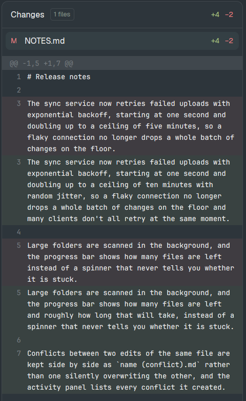

# herdr-panel-wrap

**Long lines wrap in the Files and Changes panels of the [Herdr](https://herdr.dev) desktop app.**

Herdr's side panels are a narrow column (368px by default). In Herdr app 0.1.11, a long line there (a paragraph of Markdown, a minified file, an SVG path) can only be read by scrolling sideways, and long file names are cut off. This mod makes them wrap:

- **Changes:** each diff line wraps onto as many rows as it needs, with its line number on the first row. No horizontal scrollbar.
- **Files:** the file preview soft-wraps, and long names in the tree wrap instead of being cut off.



It's two mods, `files-wrap` and `changes-wrap`: copies of Herdr's own `files` and `changes` with the change from [herdr-app#248](https://github.com/herdrdev/herdr-app/pull/248) by [@samitooooo](https://github.com/samitooooo). Herdr asks for changes to its shipped mods to live in clones ([#41](https://github.com/herdrdev/herdr-app/pull/41)), so here they are as a mod you can install.

## Install

```sh
git clone https://github.com/manastalukdar/herdr-panel-wrap
python3 herdr-panel-wrap/scripts/install.py
```

The installer:

- runs `herdr-app check` on both mods and copies them to `~/.config/herdr-app/mods/` (it won't overwrite an existing copy);
- points the current layout's Files and Changes panels at them. If that's one of Herdr's own layouts (`main`, ...), it clones it first as `<name>-wrap` and switches to it, since Herdr replaces its own layouts on every start. A layout of your own is edited in place, after a backup in `~/.config/herdr-app/data/panel-wrap/`.

`--dry-run` shows what would change. `--update` copies newer mods over an install. `--uninstall` points your layouts back at `files` and `changes` and removes the mods.

By hand: copy `mods/files-wrap` and `mods/changes-wrap` into `~/.config/herdr-app/mods/`, then in your layout change the panel blocks' `"mod": "files"` and `"mod": "changes"` to `files-wrap` and `changes-wrap`.

Needs Herdr app and Python 3 (for the installer). The mods do exactly what Herdr's own `files` and `changes` do: they run `git` (and `sh`, or PowerShell on Windows, to list a folder) and read files in the focused pane's repository. No network.

## When Herdr fixes this

These are copies of Herdr app 0.1.11's mods, so they don't get Herdr's later fixes to `files` and `changes`. If Herdr ships wrapping (watch #248), run `scripts/install.py --uninstall` and you're back on Herdr's own panels.

## Trade-off

The Changes panel draws its rows with GPUI's `list`, which measures each visible row as it draws, in place of the uniform-height list. A normal diff is fine; scrolling a very large diff fast costs more than before.

## License

Apache-2.0, like the Herdr mods these are copied from. See [NOTICE](NOTICE).
