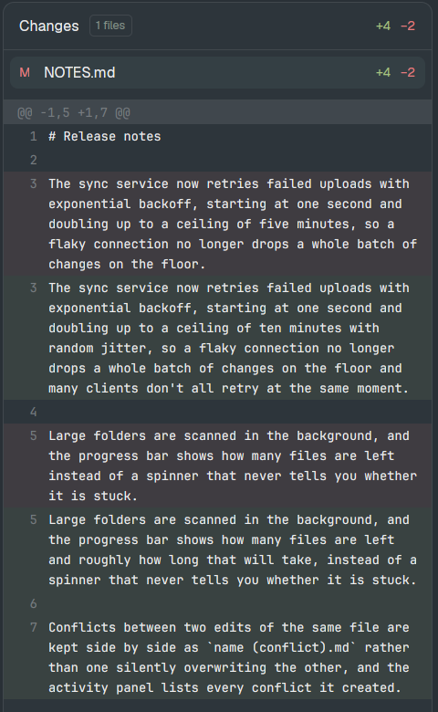

# Panel Wrap

Herdr's Files and Changes side panels, with long lines wrapped instead of scrolling sideways: each diff line in Changes wraps onto as many rows as it needs, the Files preview soft-wraps, and long names in the file tree wrap instead of being cut off.

## What you see

- **Changes panel** (Herdr's, in the right-hand panel column, 368px by default): the header, the file list and the diff look and behave as Herdr's own `changes`, except for the diff rows. A diff row is at least 20px tall, the line number in its gutter sits on the first row (`items_start`), and the text wraps at the panel's width onto as many rows as it needs. Removed lines on the red-tinted background, added on green, as in Herdr's. There is no horizontal scrollbar, only the vertical one.
- **Files panel** (Herdr's `files`): tree rows are at least 28px tall with 4px above and below, and a long name wraps onto more rows instead of being truncated. The read-only file preview soft-wraps long lines.

## How it behaves

- Everything else is Herdr's: which repository is shown (the focused pane's), refresh on file changes, the commit box, opening and folding folders, the preview's size limit (400,000 characters) and binary-file message.
- Narrowing or widening the panel re-wraps at once.
- No agent statuses: these panels don't show any.

## Built from

- **Mod** `mods/changes-wrap/`: `mod.clone` of Herdr's `changes` (Herdr app 0.1.11). Changed: the diff's uniform-height `v_virtual_list` inside `overflow_x_scrollbar` becomes GPUI's `list`, which measures each row as it draws; rows drop `truncate()` and the fixed 20px height for `min_h(20)` and `items_start()`; the horizontal scrollbar and `diffWidth` (the longest line's width) are gone.
- **Mod** `mods/files-wrap/`: `mod.clone` of Herdr's `files` (0.1.11). Changed: `soft_wrap: true` on the preview's `EditorState`; tree rows `min_h(28)` and `py(4)` in place of `h(28)`, and the name's `truncate()` removed.
- Both changes are herdr-app PR #248 by samitooooo, applied to the clones. `mod.clone` rewrites the mods' own asset paths (`mods/files/chevron-down.svg` becomes `mods/files-wrap/chevron-down.svg`), so the PR's diff doesn't apply to a clone as-is.
- **Layout**: no layout of its own. The installer points the current layout's `files` and `changes` blocks at `files-wrap` and `changes-wrap` (cloning one of Herdr's own layouts first, as `<name>-wrap`).
- **herdr**: as Herdr's `files` and `changes`: `exec` (`git`, `sh` or PowerShell to list a folder), `readTextFile`, `watchFolder`, `spaces`, `panes`, `focused`, `theme`, `settings`.

## Watch out

- `list` enters the host once per visible row per frame, where `v_virtual_list` made one call for the whole visible range. Fine for normal diffs; a very large diff scrolled fast costs more.
- Wrapping without a text-measurement API needs `list`; estimating columns from the font size instead breaks with non-default fonts.
- These are frozen copies of 0.1.11's mods: Herdr's later fixes to `files` and `changes` don't reach them. Rebuild from Herdr's current mods when it updates them.
- Herdr replaces its own layouts on every start, so pointing `main`'s blocks at the clones doesn't stick: clone the layout first.

## Done when

- `herdr-app check` passes for `mods/files-wrap` and `mods/changes-wrap`.
- In a repository with a changed line longer than the panel is wide, the Changes diff shows it on several rows, with only a vertical scrollbar.
- Opening a file with a 2,000-character line in Files shows it wrapped, with no horizontal scroll.
- A file named longer than the panel is wide shows its whole name in the tree, on two or more rows.
